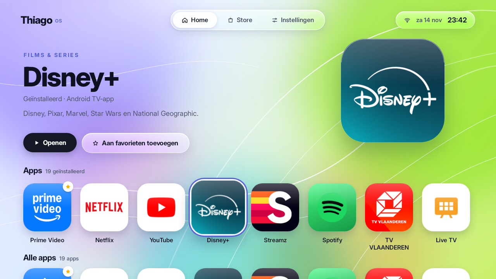
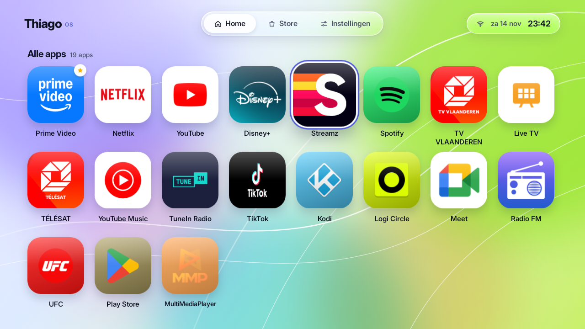
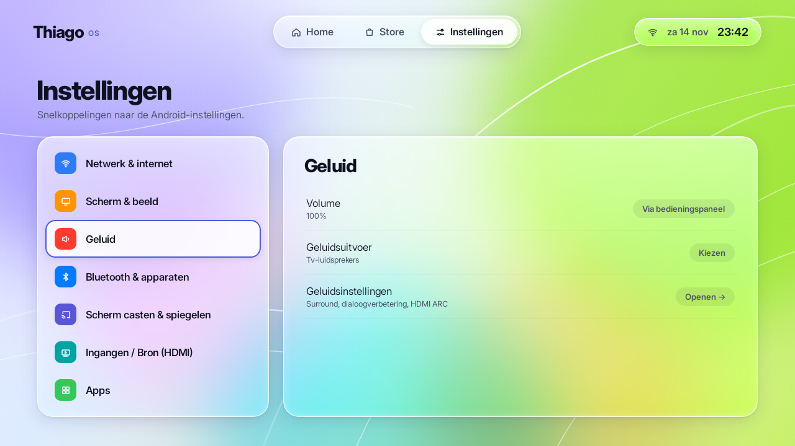
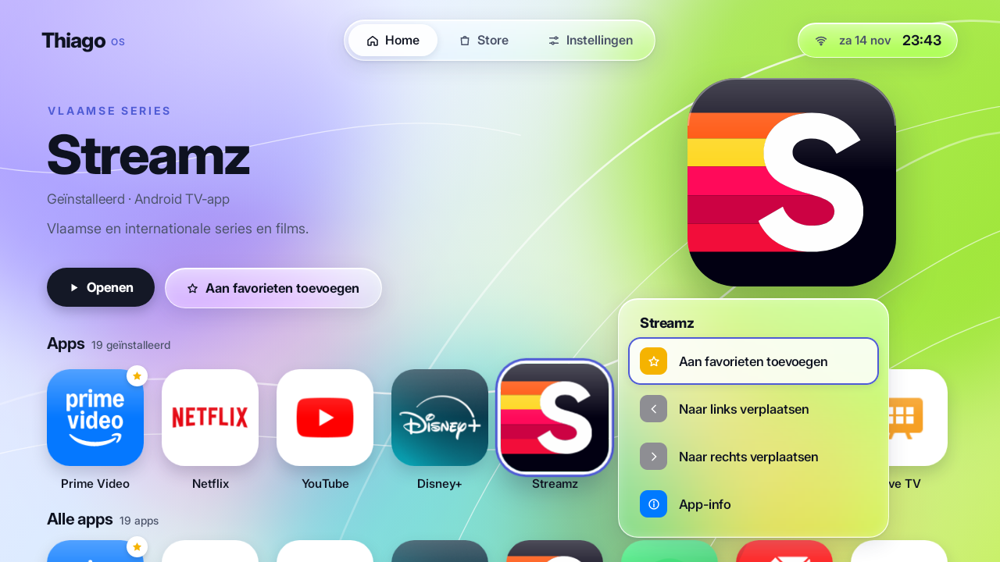

# Thiago OS — a fast, ad-free home screen for Android TV



Stock Android TV home screens are full of ads, "recommended" rows and autoplaying trailers — and on budget TVs they stutter.
**Thiago OS** replaces the home screen with a clean "liquid glass" launcher that only shows *your* apps.

Measured on a budget Android TV (Android 11, 1 GB RAM):

| | Stock Google TV launcher | Thiago OS |
|---|---|---|
| Memory (PSS) | 137 MB | **61 MB** (−55%) |
| Graphics memory | 52 MB | **9 MB** (−83%) |
| Cold start | – | **~0.55 s** |
| App size | – | **1.8 MB** |
| Ads | yes | **none** |

## Features

- Featured app with big icon, description and *Open* / *Favourite* buttons
- App row (favourites first) and a full 8-column app grid
- Long-press OK: favourite, move left/right, app info
- English and Dutch interface (automatic, or choose under Settings → Language)
- Settings page with shortcuts to the real Android settings (network, picture, sound, Bluetooth, casting, HDMI inputs, apps, date & time)
- Control panel: Wi-Fi / Bluetooth / Cast / input / Do-not-disturb status, volume and brightness sliders
- Opens the Google Play Store, launches HDMI inputs directly
- No network traffic, no tracking, no analytics. Permissions: `QUERY_ALL_PACKAGES`, `ACCESS_NETWORK_STATE`, `ACCESS_WIFI_STATE`, optional `WRITE_SETTINGS` (brightness)
- Built for slow hardware: Jetpack Compose, R8, Baseline Profile, pre-rendered glass/shadows, GPU-only bitmaps

| All apps | Settings | Long-press menu |
|---|---|---|
|  |  |  |

> Available in **English** and **Dutch**. It follows your TV's language automatically; change it any time under *Settings → Language*.

## Install

📖 **Step-by-step install guide:** <https://thiagofernandezguillen-rgb.github.io/thiago-os/install.html>
🇳🇱🇧🇪 **Nederlandstalige gids:** <https://thiagofernandezguillen-rgb.github.io/thiago-os/installeren.html>

Requirements: Android TV / Google TV, Android 7.0 (API 24) or newer.

**Easiest — Windows, one line** (TV: enable *Developer options → USB debugging*; PC and TV on the same network). Open PowerShell and paste:

```powershell
irm https://thiagofernandezguillen-rgb.github.io/thiago-os/install.ps1 | iex
```

It downloads Google's official `adb` and the latest APK, installs Thiago OS, opens the *Home app* chooser and — only if you say yes — disables the stock launcher. Run it again and choose **2** to undo everything. ([read the script](docs/install.ps1))

**TV only — Downloader app:** install *Downloader* from the Play Store, allow it under *Unknown sources*, and enter
`thiagofernandezguillen-rgb.github.io/thiago-os/ThiagoOS.apk`

**Manual (adb):**

```
adb connect <tv-ip>:5555
adb install ThiagoOS.apk
adb shell am start -a android.settings.HOME_SETTINGS
```

Latest APK: [ThiagoOS.apk](https://github.com/thiagofernandezguillen-rgb/thiago-os/releases/latest/download/ThiagoOS.apk)

### The Home button still opens the old launcher?

On many Android TV devices the stock launcher has a higher built-in priority and keeps grabbing the Home button even after you pick another home app.
The only fix is to **disable** (not uninstall) the stock launcher — fully reversible:

```
adb shell pm disable-user --user 0 com.google.android.tvlauncher
adb shell pm disable-user --user 0 com.google.android.tvrecommendations
```

Undo at any time:

```
adb shell pm enable com.google.android.tvlauncher
adb shell pm enable com.google.android.tvrecommendations
```

⚠️ Do this at your own risk. Never uninstall system apps. Package names can differ per manufacturer.

### Uninstall

```
adb shell pm enable com.google.android.tvlauncher   # if you disabled it
adb uninstall be.nova.os
```

## Build from source

Requires JDK 17+ and the Android SDK (API 37).

```
cd app-project
./gradlew :app:assembleRelease
```

The APK lands in `app-project/app/build/outputs/apk/release/`.
The Baseline Profile in `app/src/release/generated/baselineProfiles/` can be regenerated on an emulator with
`./gradlew :app:generateReleaseBaselineProfile`.

> The release build is currently signed with the local debug key. For your own releases, create a release keystore and configure `signingConfigs` in `app/build.gradle.kts`.

## Contributing

Issues and pull requests are welcome — especially translations (English, French, German, …) and support for more TV brands.

## Credits & license

- Code: [MIT License](LICENSE)
- Font: [Inter](https://rsms.me/inter/) by Rasmus Andersson — SIL Open Font License 1.1 (`app/src/main/assets/fonts/Inter-OFL.txt`)
- App names and icons shown in screenshots belong to their respective owners. Thiago OS is not affiliated with Google or any TV manufacturer.

---

### 🇧🇪 In het kort (Nederlands)

Thiago OS is een snel startscherm zonder reclame voor Android TV. Installeer de APK, kies Thiago OS als standaard Home-app en zet desnoods de oude launcher uit met `pm disable-user` (omkeerbaar met `pm enable`). Beschikbaar in het Nederlands en het Engels (Instellingen → Taal).
